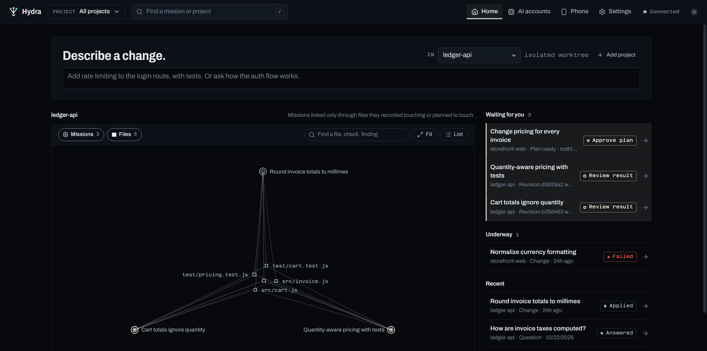
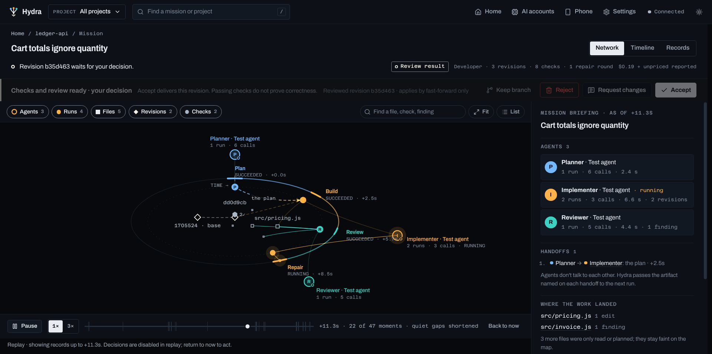

# Hydra

Hydra is a desktop app that supervises AI coding agents (Claude Code and Codex CLI). Ask it a question and it answers; ask it for a change and it plans, implements, reviews and verifies the change in isolation, then waits for your approval.

**PLAN → IMPLEMENT → REVIEW → FIX → VERIFY → DEMO → APPROVAL**


- **Isolated changes.** Every change runs in its own git worktree on a `hydra/*` branch. Hydra delivers a task revision only after your approval. Recorded applies offer revert-based rollback, subject to branch state and conflict resolution. Project checks still execute as your user; use trusted repositories.
- **Evidence, not claims.** Hydra runs your project's tests and builds itself (Node, Python, Go, Rust, Java, C/C++, or your own `.hydra/checks.json`), records exit codes against the exact commit, and shows before/after results.
- **Independent review.** A second agent (a different provider when available) reviews the diff together with the real test results. Fix rounds are bounded.
- **Budgets.** Per-task limits on cost, tokens, active time and agent runs.
- **Your accounts, your bill.** Hydra uses *your* locally signed-in Claude Code and Codex CLIs. It never stores, proxies or ships credentials.
- **Your data stays local.** Everything is in a local SQLite database. Remote control from a phone on your network is end-to-end encrypted, and no cloud database is involved.

## A look inside

Every mission opens on an evidence map drawn only from what Hydra recorded: no invented agent chatter, progress bars or success states. Anything derived from a stated rule is marked as derived.

| | |
|---|---|
|  |  |
| **Home.** Describe a change or ask a question. Missions are linked only through the files they recorded touching, and anything waiting for you is listed first. | **Night and Day themes.** Stages run clockwise around the mission clock. Revisions sit inside it, oldest on the left, and each carries a badge counting its checks. |
|  |  |
| **Replay.** Step back through recorded time. Later records are hidden and outcomes never leak backwards. Each newly recorded handoff or result lights up once, and decisions are disabled until you return to now. | **Agents and handoffs.** An agent is one role on one provider (Claude Code or Codex CLI). An arrow is drawn only where a recorded artifact went from one run to the next: the plan, a revision, findings or failed checks. |
|  |  |
| **Timeline.** The same records laid out in lanes: you, the agents, edits by file, and the checks Hydra ran. | **Acceptance gates.** When a check fails, Hydra refuses acceptance and says why. You can send the change back for repair, keep its branch, or reject it. |

<sub>Screenshots: the packaged desktop app at 1536×764 (a maximized window on a 1920×1080 display at 125 %), showing recorded fixture missions. These are the real Hydra engine, Git and project checks, driven by scripted test agents instead of model providers, so costs and agent output are illustrative.</sub>

## Status

**Supervised developer preview.** Historical real-provider and CI evidence is dated in [TEST_EVIDENCE](docs/v2/TEST_EVIDENCE.md); it does not qualify every current build or platform. The [Mission Desk milestone](docs/v2/PRODUCT_MILESTONE.md) simplifies the full desktop product around conversation, a revision-bound receipt and explicit decisions. Signing, public feed/recovery, hostile-code containment, trusted remote bootstrap and broader hardware/accessibility qualification remain release gates. The [full-app distribution and Agensi plan](docs/v2/AGENSI_FULL_PRODUCT.md) separates the Electron application from any standalone companion skill. Nothing has been published by this milestone.

## Develop

Requires Node ≥ 22.13 and git.

```bash
npm install
npm run check      # typecheck, lint, tests, originality check
npm run desktop    # build and launch the desktop app
```

## Licence

Copyright © 2026 Melek Moalla. All rights reserved. No licence is granted until a licence file is added.
