<div align="center">


# Hydra

**Many coding agents. One supervisor. Nothing lands without proof and your approval.**

Hydra is a desktop app that runs Claude Code and Codex CLI as a team: one plans, one builds, another reviews. Hydra runs your real tests itself and shows you exactly what happened before anything touches your code.


<sub>A real mission replayed in Hydra: <i>"improve everything, u have full autonomy"</i> on a Python computer-vision project. Planner and reviewer on Claude Code, implementer on Codex CLI. Every mark and pulse comes from a recorded event.</sub>

</div>

---

## The pipeline

**PLAN → IMPLEMENT → REVIEW → FIX → VERIFY → DEMO → APPROVAL**


- **Isolated changes.** Every change runs in its own git worktree on a `hydra/*` branch. Hydra delivers a revision only after your approval. Recorded applies offer revert-based rollback, subject to branch state and conflict resolution. Project checks still run as your user, so use repositories you trust.
- **Evidence, not claims.** Hydra runs your project's tests and builds itself (Node, Python, Go, Rust, Java, C/C++, or your own `.hydra/checks.json`). It records exit codes against the exact commit and shows before and after results. An agent saying "tests pass" is never evidence.
- **Independent review.** A second agent (a different provider when available) reviews the diff together with the real test results. Fix rounds are bounded.
- **Explains itself.** Click anything on a map (a file, a check, a finding, a run) and your own Claude Code or Codex explains what it is in your project and what happened to it, read-only.
- **Budgets.** Per-task limits on cost, tokens, active time and agent runs.
- **Your accounts, your bill.** Hydra uses *your* locally signed-in Claude Code and Codex CLIs. It never stores, proxies or ships credentials.
- **Your data stays local.** Everything lives in a local SQLite database. Remote control from a phone on your network is end-to-end encrypted, and no cloud database is involved.

## Two real missions

Both ran on the same night in October 2026, from open-ended prompts that handed the agents "full autonomy".

| | **telekinisis** · *"improve it, u have full liberty to act autonomously"* | **Vector** · *"improve everything, u have full autonomy"* |
|---|---|---|
| Team | Planner and reviewer on Claude Code, implementer on Codex CLI | Same team |
| Work | 5 agent runs, 3 revisions, 1 repair round | 7 agent runs, 4 revisions, 2 repair rounds |
| Review | **Approved**: no blocker or major problem | **Changes requested** (3 findings across its reviews) |
| Hydra's own checks | `unittest` **fail → pass**, no regressions | `pytest` **pass → fail**: a regression |
| Outcome | Branch kept | Branch kept, **nothing applied to the project** |
| Reported cost | $0.99 + unpriced Codex usage | $1.45 + unpriced Codex usage |

The second mission is the interesting one. The planner refused to boil the ocean:

> *"Improve everything" is too broad to deliver in one reviewable change, so this plan targets the most valuable gaps I found: robustness and safety in the live runtime path (camera, vision worker, app startup and shutdown).*

The implementer delivered camera recovery, stall handling and resource cleanup. The reviewer found a real problem in the new tests. Hydra's own before/after run showed `pytest` passing on the original commit and failing on the final one. So nothing was merged. The work stayed on its branch, and the evidence for why is one click away.

## A tour of the app

<sub>Unless a caption says otherwise, every screen below is the packaged desktop app at 1536×864 (125 % scaling on a 1920×1080 display) running on a read-only copy of the owner's own Hydra records: real projects, prompts, agents and output. Screens marked <b>recorded test mission</b> come from missions recorded with the real engine, Git and checks but scripted agents, to show states the owner's own missions never reached.</sub>

### Home

<table>
<tr>
<td width="50%">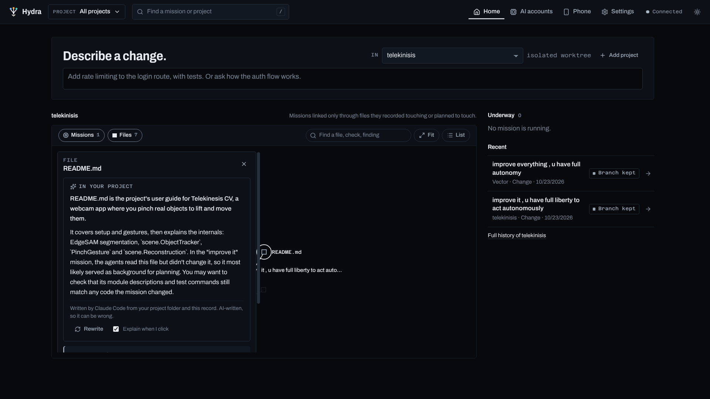</td>
<td width="50%">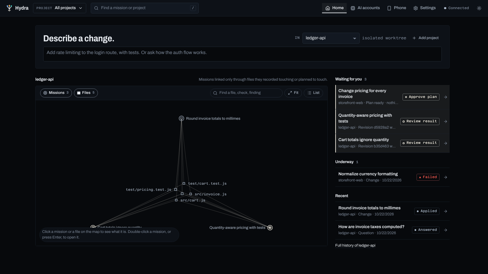</td>
</tr>
<tr>
<td><b>Describe a change, see the project.</b> Missions are linked through the files they touched. Click a file or a mission and Hydra says what it is, in your project (here: <code>README.md</code>, explained by the owner's own Claude Code).</td>
<td><b>What needs you comes first.</b> Waiting decisions, missions underway and recent outcomes, each with its state. <i>Recorded test missions.</i></td>
</tr>
</table>

### The mission map


<sub><b>The mission clock.</b> Stages run clockwise in recorded order. Agents sit outside the clock, each one a role on a provider (here Claude Code plans and reviews, Codex CLI builds). Arrows are handoffs Hydra actually made: the plan, a revision, review findings, failed checks. Revisions run left to right inside, each with a badge counting its checks. The briefing on the right is computed from the records.</sub>

<table>
<tr>
<td width="50%"></td>
<td width="50%"></td>
</tr>
<tr>
<td><b>Focus on an agent.</b> Everything else dims. Its runs, reported tool calls, edits, revisions and token usage come straight from the run records.</td>
<td><b>Follow a revision.</b> The exact commit, the checks Hydra ran on it, the run that produced it and the review that read it.</td>
</tr>
<tr>
<td></td>
<td></td>
</tr>
<tr>
<td><b>Every mission gets its own map.</b> The telekinisis run: plan, build, review, one repair round, a second review, then checks that went from failing to passing.</td>
<td><b>Night and Day.</b> Two full themes, designed together. Red always means something stopped.</td>
</tr>
</table>

**Replay** (the animation at the top) steps through recorded time. Later records are hidden and outcomes never leak backwards. Each newly recorded handoff or result lights up once, and decisions are disabled until you return to the present.

### Click anything: it explains itself

Every dot on every map has two explanations. **In your project** is written on the spot by *your own* Claude Code or Codex, reading that project's files and the record, so it can say what a file is for or why a check failed. It runs read-only, is cached per dot, is labelled as AI-written, and can be switched off. **From Hydra's records** states the recorded facts in plain sentences, with no AI involved.

<table>
<tr>
<td width="50%">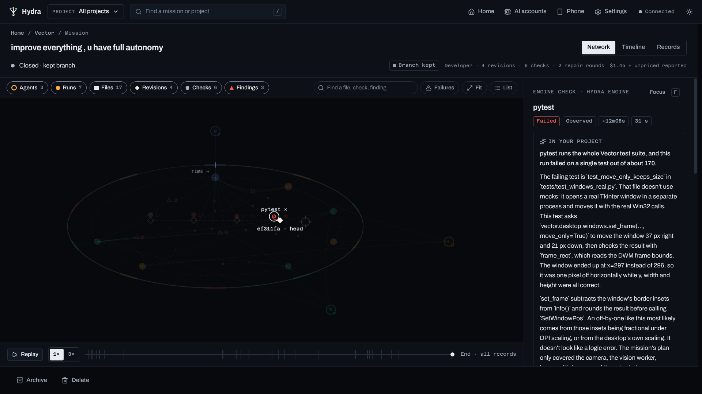</td>
<td width="50%">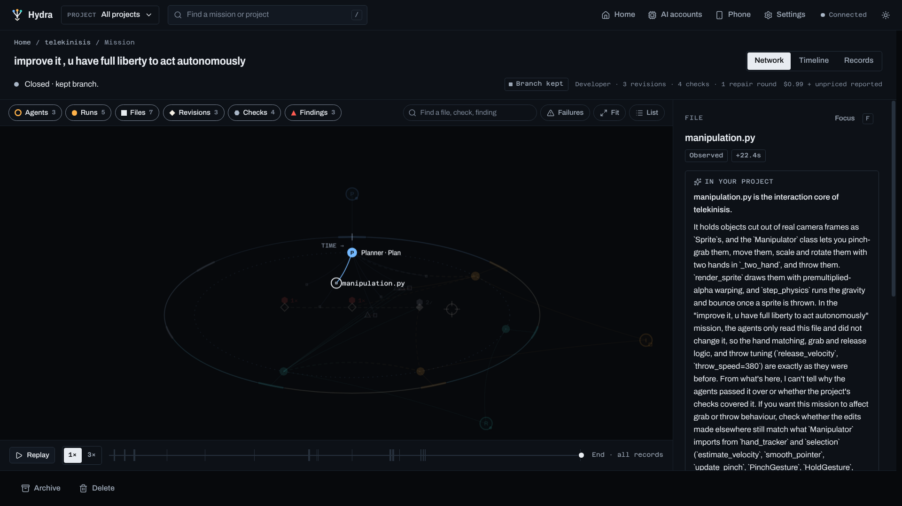</td>
</tr>
<tr>
<td><b>Why did this check fail?</b> One test out of about 170 failed: the window landed at x=297 instead of 296. The explanation traces it to rounding of DPI-scaled border insets in <code>set_frame</code> and suggests re-running that test on unmodified <code>main</code>.</td>
<td><b>What is this file?</b> <code>manipulation.py</code> "is the interaction core of telekinisis": the <code>Manipulator</code> class, pinch-grab, two-hand scale and rotate, throwing.</td>
</tr>
<tr>
<td>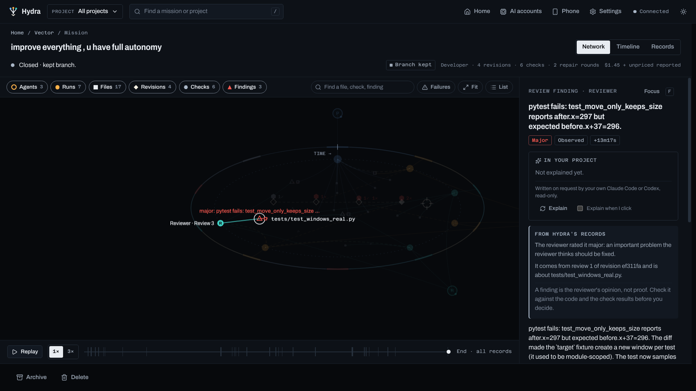</td>
<td>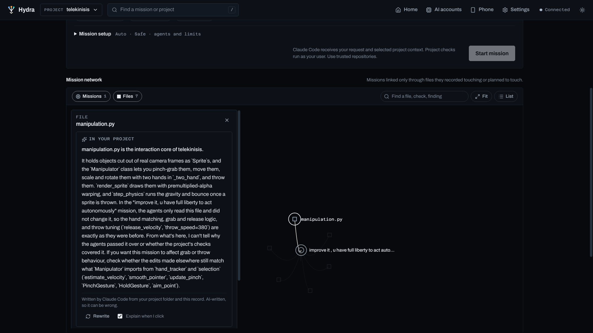</td>
</tr>
<tr>
<td><b>Review findings</b> keep the reviewer's own words, with the severity explained. Automatic explanations were switched off here, so the panel offers the <b>Explain</b> button instead.</td>
<td><b>Project pages</b> show a project's history and mission network, with the same explanations on click.</td>
</tr>
</table>

<sub>The explanations shown were written by the owner's Claude Code on his own PC and are replayed verbatim in these screenshots.</sub>

### Timeline and records

<table>
<tr>
<td width="50%"></td>
<td width="50%">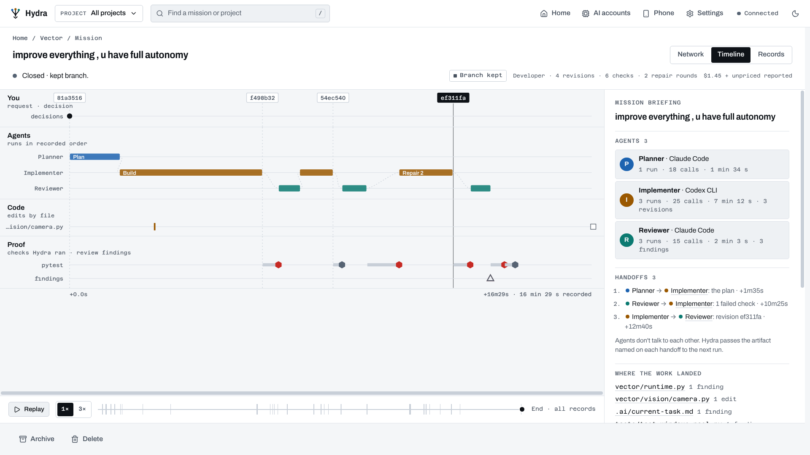</td>
</tr>
<tr>
<td colspan="2"><b>Timeline.</b> The same records in lanes: you, each agent, edits by file and every check Hydra ran, across the mission's 16 recorded minutes.</td>
</tr>
<tr>
<td></td>
<td>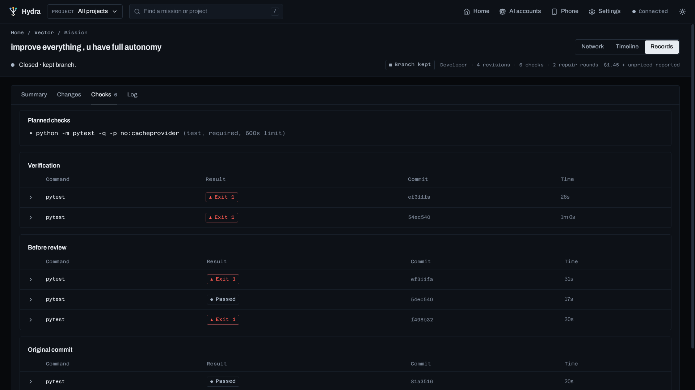</td>
</tr>
<tr>
<td><b>Records → Summary.</b> The full plan and the before/after comparison: <code>pytest</code> pass → fail, flagged as a regression.</td>
<td><b>Records → Checks.</b> Every command Hydra ran, with exit code, exact commit and duration, grouped by phase.</td>
</tr>
</table>

### Your decision

<table>
<tr>
<td width="50%">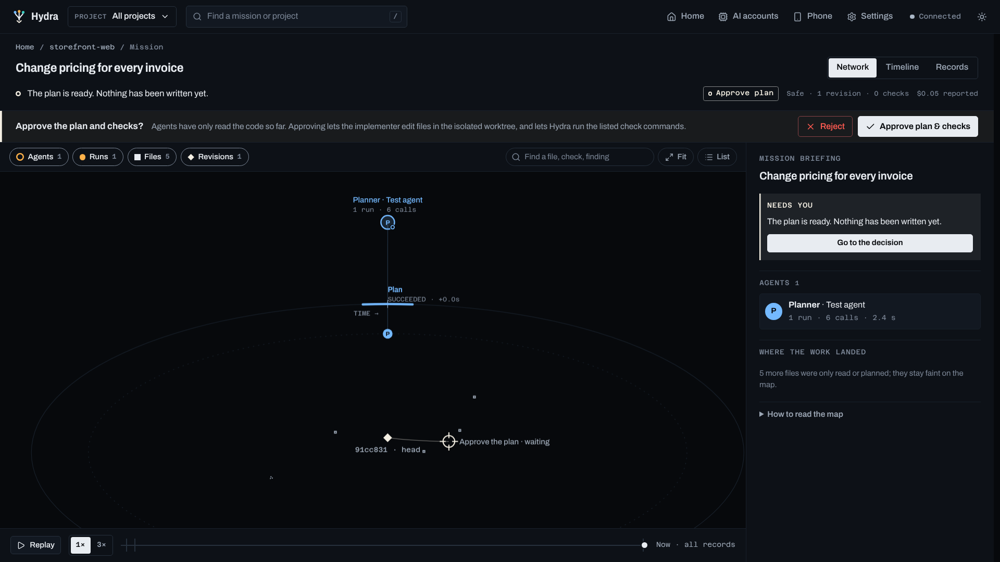</td>
<td width="50%">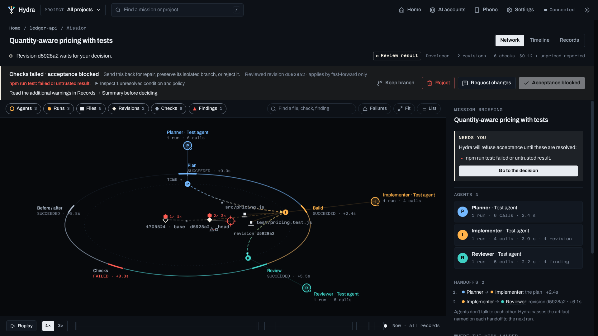</td>
</tr>
<tr>
<td><b>Approve the plan first</b> (Safe mode, or any change Hydra rates high risk). Agents have only read the code so far. <i>Recorded test mission.</i></td>
<td><b>Acceptance blocked.</b> A required check failed, so Hydra refuses to deliver and says why. You can request changes, keep the branch or reject. <i>Recorded test mission.</i></td>
</tr>
<tr>
<td>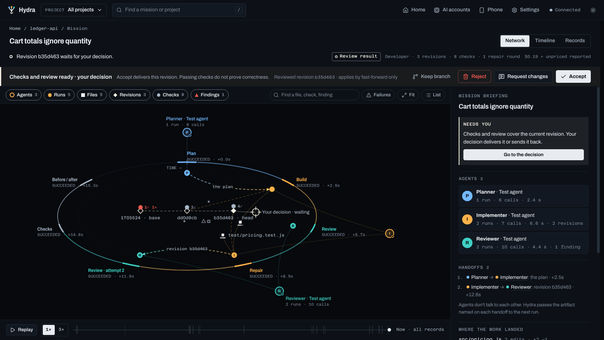</td>
<td>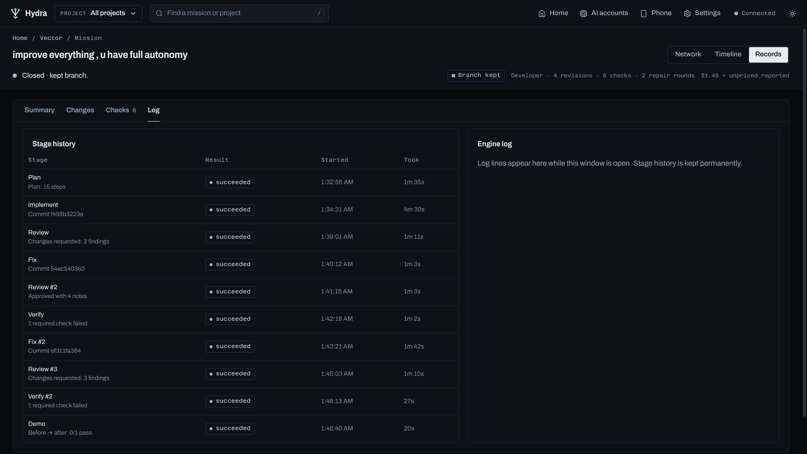</td>
</tr>
<tr>
<td><b>Ready to accept.</b> Checks and review cover this exact revision. Accept fast-forwards your branch to it; Hydra delivers nothing without that click. <i>Recorded test mission.</i></td>
<td><b>Whatever you decide, the record stays.</b> Records → Log keeps the stage history of every mission permanently.</td>
</tr>
</table>

### Accounts, phone and settings

<table>
<tr>
<td width="50%">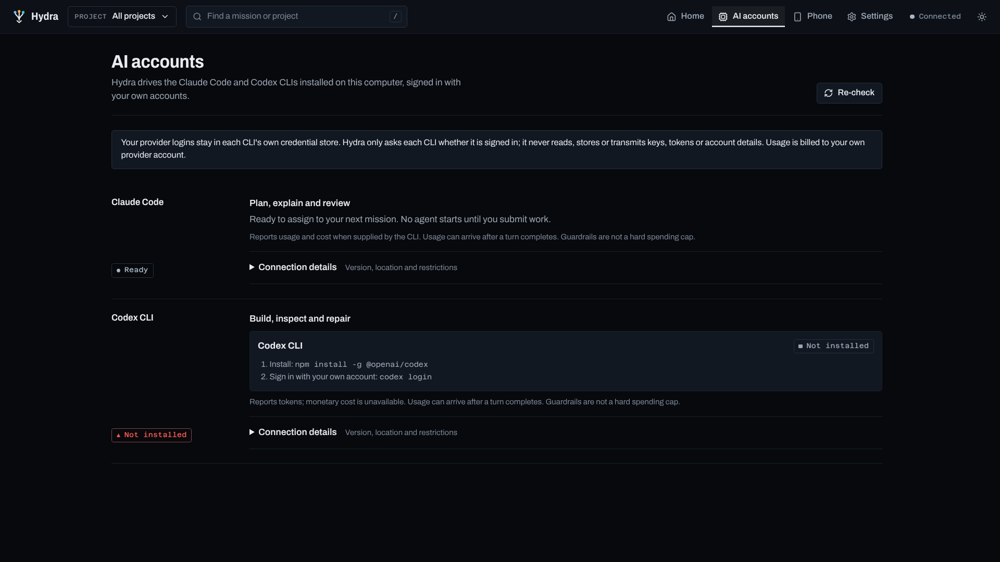</td>
<td width="50%">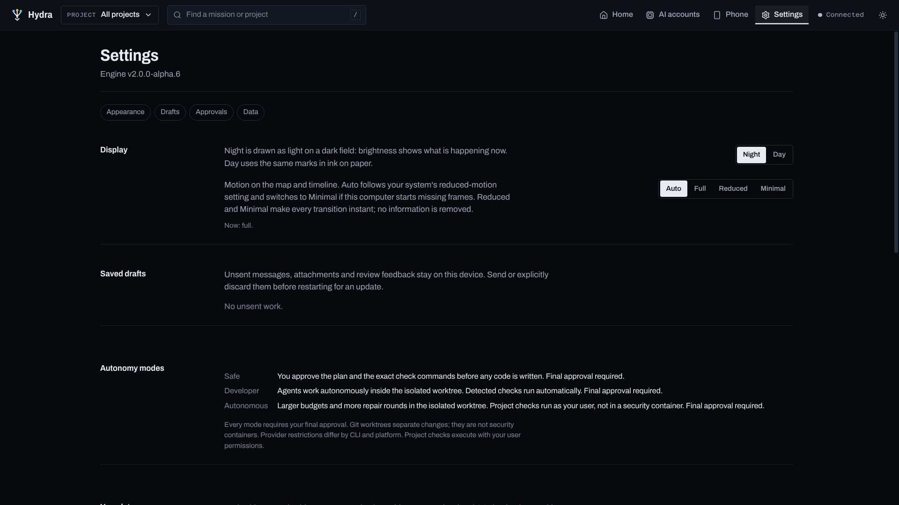</td>
</tr>
<tr>
<td><b>AI accounts.</b> Hydra only asks each CLI whether it is signed in; it never reads, stores or sends keys or tokens. <i>Shown on a machine with only Claude Code installed.</i></td>
<td><b>Settings.</b> Night or Day, motion level, saved drafts, and the three autonomy modes. Every mode still requires your final approval.</td>
</tr>
<tr>
<td>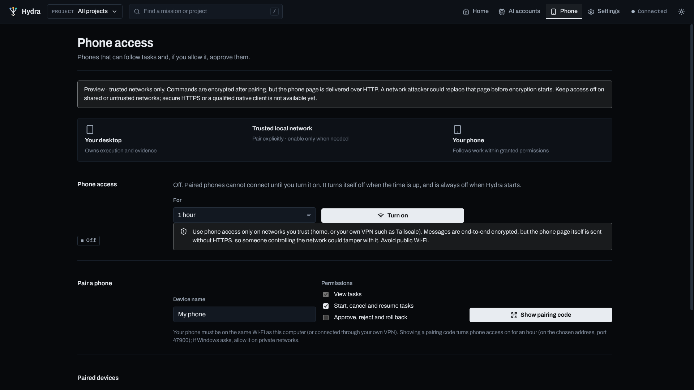</td>
<td>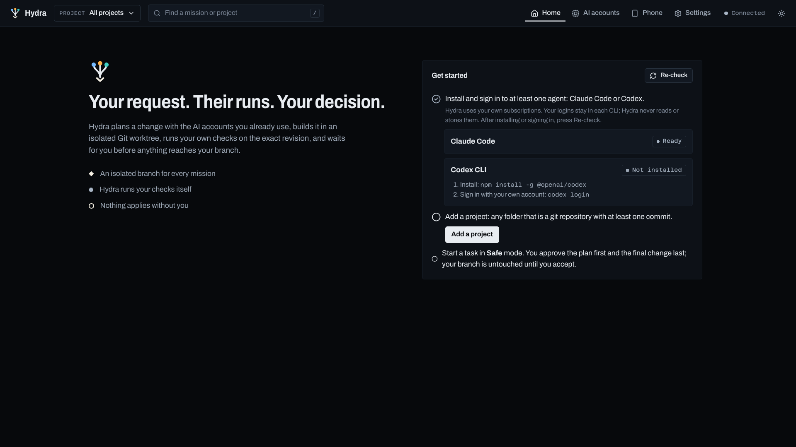</td>
</tr>
<tr>
<td><b>Phone access</b> is off by default, switches itself off after a set time, and pairs each phone with explicit permissions. Preview: trusted networks only.</td>
<td><b>First run.</b> Sign in to Claude Code or Codex, add a Git project, start in Safe mode.</td>
</tr>
</table>

## How it is built

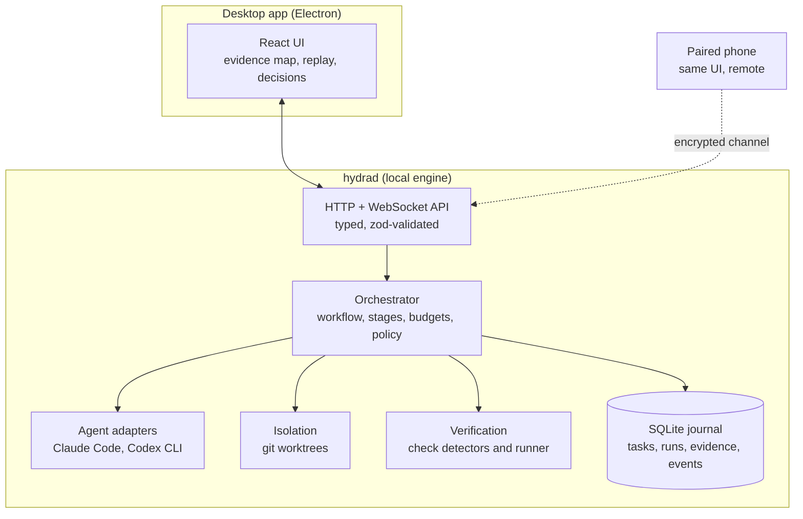

| Package | What it does |
|---|---|
| [`packages/engine`](packages/engine) | The orchestration engine as a library: store, workflow, stages, adapters, isolation, verification, budget, policy. |
| [`packages/protocol`](packages/protocol) | Versioned zod schemas for every domain type, API call and event. |
| [`packages/secure-channel`](packages/secure-channel) | Pairing and session cryptography shared by the engine and the phone client. |
| [`packages/ui`](packages/ui) | The React interface, including the canvas evidence map, replay and the read-only evidence graph adapter. |
| [`apps/hydrad`](apps/hydrad) | Engine host: HTTP/WebSocket API, static UI, remote bridge, CLI (`hydrad serve`, `hydrad doctor`). |
| [`apps/desktop`](apps/desktop) | Electron shell: starts hydrad, opens the window, native dialogs and updates. |

The workflow never branches on "Claude" or "Codex". It asks adapters for capabilities, so providers are interchangeable per role. Every restriction is labelled honestly as enforced by the OS, by the provider CLI, or by a prompt only. More detail: [Architecture](docs/v2/ARCHITECTURE.md) · [Threat model](docs/v2/THREAT_MODEL.md) · [Decisions](docs/v2/DECISIONS.md) · [User guide](docs/v2/USER_GUIDE.md).

## Status

**Supervised developer preview.** Historical real-provider and CI evidence is dated in [TEST_EVIDENCE](docs/v2/TEST_EVIDENCE.md); it does not qualify every current build or platform. Signing, public update feed and recovery, hostile-code containment, trusted remote bootstrap and broader hardware and accessibility qualification remain release gates. Nothing has been published as a release.

## Develop

Requires Node ≥ 22.13 and git, plus Claude Code and/or Codex CLI signed in on your machine.

```bash
npm install
npm run check      # typecheck, lint, tests, originality check
npm run desktop    # build and launch the desktop app
```

## Licence

Copyright © 2026 Melek Moalla. All rights reserved. No licence is granted until a licence file is added.
